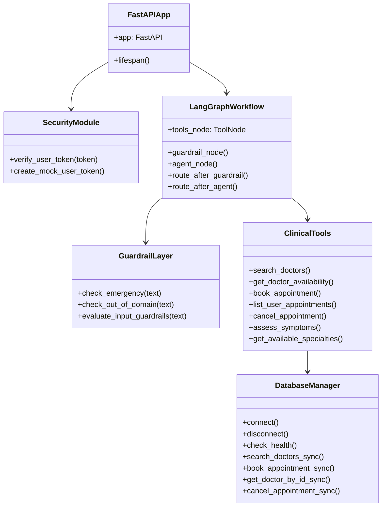
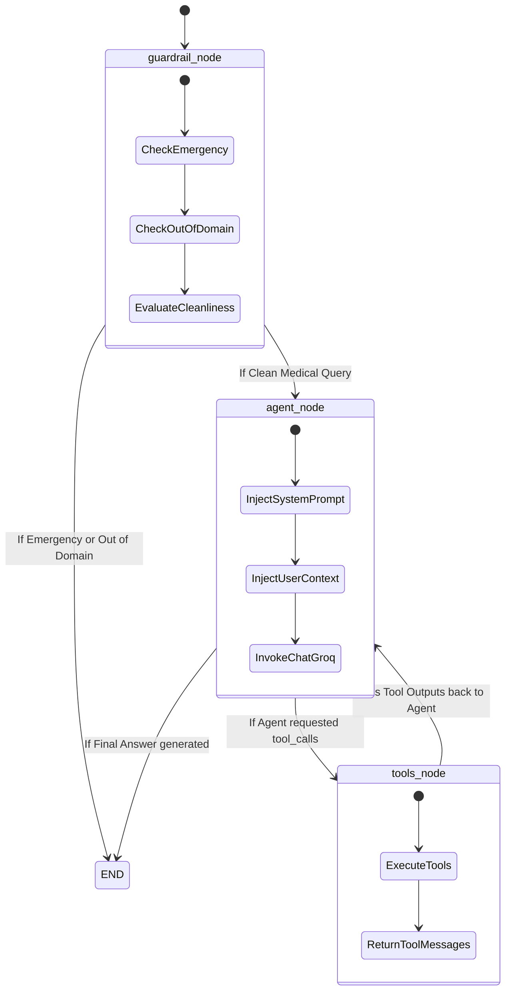

# DocAppointment AI Agent Architecture

This document outlines the architectural design, state machines, database synchronization, and safety guardrails of the DocAppointment AI Agent service.

---

## 1. Architectural Principles

The AI Agent follows a Guardrail-Enforced, State-Orchestrated Agentic Pattern:
1. **Clinical Safety Boundary**: Clinical queries pass through safety checks (red flags and out-of-domain filters) before invoking the LLM.
2. **Authoritative Database Synchronization**: All doctor searches, schedule availability checks, and appointment reservations query the primary MongoDB collections (`doctormodels`, `appointmentmodels`, `usermodels`) shared with the Node.js Modular Monolith.
3. **Multi-Turn Context Awareness**: Conversations retain state across user turns through LangGraph's checkpointer mechanism without requiring the client to store or transmit complete chat histories.
4. **Dual Execution Runtime**: Endpoints support synchronous threadpool execution (`POST /api/chat`) and streaming Server-Sent Events (`POST /api/chat/stream`).

---

## 2. Component Design



---

## 3. LangGraph Workflow Graph



### State Schema (`AgentState`)
```python
class AgentState(TypedDict, total=False):
    messages: Annotated[List[AnyMessage], add_messages]
    user_id: Optional[str]
    user_name: Optional[str]
    user_email: Optional[str]
    session_id: Optional[str]
    is_emergency: bool
    is_blocked: bool
    block_reason: Optional[str]
    triage_data: Optional[Dict[str, Any]]
```

---

## 4. MongoDB Schema Contract

The AI agent interacts directly with MongoDB collections created and maintained by the Node.js backend:

### Collection: `doctormodels`
Defined in `backend/src/modules/doctor/doctor.model.ts`:
- `name`: Full name of the doctor.
- `speciality`: Medical specialty (e.g., General physician, Dermatologist, Gynecologist, Pediatricians, Neurologist, Gastroenterologist).
- `fees`: Consultation fee in INR.
- `available`: Boolean availability toggle.
- `slots_booked`: Dictionary of date keys (`D_M_YYYY`) mapping to lists of booked time strings (e.g., `{"18_11_2026": ["10:00 AM"]}`).

### Collection: `appointmentmodels`
Defined in `backend/src/modules/appointment/appointment.model.ts`:
- `userId`: String identifier of the patient.
- `docId`: String identifier of the doctor.
- `slotDate`: Date string (`18_11_2026`).
- `slotTime`: Time string (`10:00 AM`).
- `userData`: Object containing patient profile snapshot.
- `docData`: Object containing doctor profile snapshot.
- `amount`: Number matching doctor consultation fee.
- `data`: Millisecond timestamp matching JavaScript `Date.now()`.
- `cancelled`: Boolean (`false` on creation).
- `payment`: Boolean (`false` on creation).
- `isCompleted`: Boolean (`false` on creation).

---

## 5. Medical Safety Protocols

1. **Emergency Red-Flag Interception**:
   - Monitored patterns: Crushing chest pain, acute dyspnea, stroke signs (facial drooping, slurred speech), anaphylaxis, massive hemorrhage, suicidal ideation, poison exposure.
   - Action: Intercepts before LLM execution, returning urgent instructions to call emergency services (112, 911, or 108) or proceed to the nearest emergency room.

2. **Domain Boundary Defense**:
   - Monitored patterns: Non-medical inquiries including software development, cryptocurrency, financial investments, academic homework, politics, or entertainment.
   - Action: Courteously declines and prompts the patient for health-related queries.

---

## 6. Container Orchestration & Compose Architecture

The AI agent service is configured for container orchestration within `docker-compose.yml`:
- **Network**: Operates within `docappoint_net` alongside `docappoint_mongo` and `docappoint_backend`.
- **Service Dependency**: Depends on the healthy startup of the `mongo` service container (`service_healthy` condition via mongosh ping).
- **Environment Ingestion**: Ingests `GROQ_API_KEY`, `MONGODB_URI` (`mongodb://mongo:27017`), `MONGODB_DB_NAME`, and shared `JWT_SECRET`.
- **Healthcheck**: Dockerfile configures an active HTTP healthcheck against `/api/health` with a 30s interval and 3 retries.

