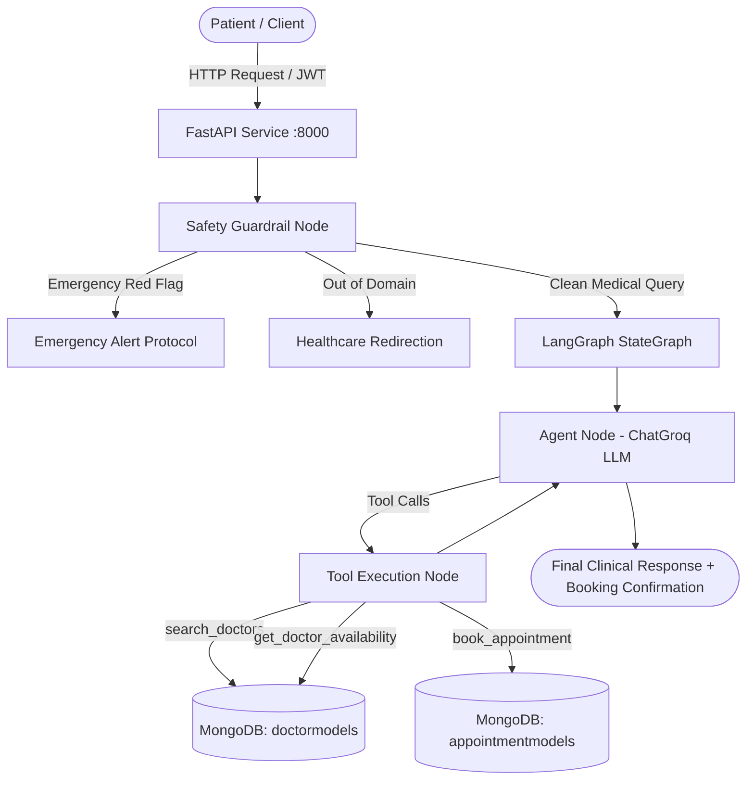

# DocAppointment AI Clinical Agent Service

A production-grade, clinical triage and doctor appointment booking AI agent service built with FastAPI, LangGraph, LangChain, Groq API (Llama 3.3 70B / 3.1 8B), and MongoDB, packaged and managed with `uv`.

---

## Key Capabilities

1. **Basic Disease Triage and Symptom Guidance**:
   - Collects patient symptom descriptions (onset, duration, severity, accompanying symptoms).
   - Provides safe, evidence-informed initial health guidance and basic supportive care instructions.
   - Includes medical disclaimers on every turn: AI triage does not substitute for clinical evaluation or provide scheduled prescriptions.

2. **Strict Guardrails and Clinical Safety**:
   - **Emergency Red-Flag Interception**: Automatically catches life-threatening symptoms (such as crushing chest pain, acute respiratory distress, stroke symptoms, profuse hemorrhage, or anaphylaxis) and instructs the patient to contact emergency services (112, 911, or 108) or visit the nearest emergency room immediately.
   - **Domain Boundary Defense**: Rebuffs non-medical queries (such as programming, financial advice, or general trivia) and redirects the patient back to healthcare services.

3. **Database Integration**:
   - Connects to shared MongoDB collections (`doctormodels`, `appointmentmodels`, `usermodels`) used by the Node.js backend.
   - Automatically maps patient complaints to appropriate clinical specialties:
     * Dermatologist: Skin lesions, acne, rash, eczema, psoriasis.
     * Gynecologist: Women's health, pregnancy, menstrual cycle, PCOS.
     * Pediatricians: Infant and child health, pediatric fevers, immunizations.
     * Neurologist: Chronic migraines, nerve pain, seizures, dizziness.
     * Gastroenterologist: Acid reflux, GERD, digestive pain, abdominal distress.
     * General physician: Acute viral illness, fevers, coughs, routine wellness checkups.
   - Queries live doctor profiles including degrees, experience, consultation fees, and clinic addresses.

4. **Autonomous Tool Calling**:
   - `search_doctors`: Queries doctors by specialty, free-text keywords, or consultation fee limits.
   - `get_doctor_availability`: Inspects a doctor's booked slots for a given date (`DD_MM_YYYY`) and returns open consultation slots.
   - `book_appointment`: Verifies slot availability, prevents double-booking, creates the appointment document in MongoDB, and updates the doctor's calendar.
   - `list_user_appointments`: Retrieves a patient's scheduled and historical appointments.
   - `cancel_appointment`: Cancels an existing appointment and releases the slot.
   - `assess_symptoms`: Computes a structured clinical triage assessment with severity calculation and home-care recommendations.

5. **Multi-Turn Conversational Memory**:
   - Built on LangGraph state management and thread checkpointing using `MemorySaver`.
   - Preserves patient conversational context across multiple turns using `session_id`.

6. **Streaming and REST Endpoints**:
   - Standard JSON endpoint (`POST /api/chat`) with tool execution tracking.
   - Server-Sent Events endpoint (`POST /api/chat/stream`) for real-time token delivery and tool events.

---

## System Architecture



---

## Technology Stack

- **Runtime**: Python 3.11+ (Python 3.13 supported)
- **Package & Environment Manager**: `uv`
- **API Framework**: FastAPI 0.115+
- **ASGI Server**: Uvicorn
- **Agent Orchestration**: LangGraph 0.2+, LangChain 0.3+
- **LLM Engine**: ChatGroq (`llama-3.3-70b-versatile`, `llama-3.1-8b-instant`)
- **Database Access**: PyMongo 4.9+ (synchronous) & Motor 3.6+ (asynchronous)
- **Authentication**: PyJWT (shared secret verification with Node.js backend)
- **Validation & Configuration**: Pydantic 2.9+, Pydantic Settings
- **Testing**: Pytest, Pytest-Asyncio

---

## Step-by-Step Setup Guide

### Step 1: Install uv
Ensure `uv` is installed on your system:
```bash
# Windows (PowerShell)
winget install astral-sh.uv

# Or via pip
pip install uv
```

### Step 2: Install Project Dependencies
From the repository root:
```bash
cd backend/ai_agent
uv sync --extra dev
```

### Step 3: Configure Environment Variables
Copy `.env.example` to `.env`:
```bash
cp .env.example .env
```

Configure your parameters in `.env`:
```ini
HOST=0.0.0.0
PORT=8000
ENVIRONMENT=development
DEBUG=True

# Groq LLM API Configuration
# Obtain your free API key at: https://console.groq.com/keys
GROQ_API_KEY=gsk_your_groq_api_key_here
GROQ_MODEL=llama-3.3-70b-versatile
GROQ_TEMPERATURE=0.2

# MongoDB Configuration (Shared with Node backend)
MONGODB_URI=mongodb://127.0.0.1:27017
MONGODB_DB_NAME=docappoint

# Collection Names
DOCTORS_COLLECTION=doctormodels
APPOINTMENTS_COLLECTION=appointmentmodels
USERS_COLLECTION=usermodels

# Shared JWT Secret (must match backend/.env)
JWT_SECRET=lsjotg4qlijaHHFkjfdhfkvn7878secret
JWT_ALGORITHM=HS256

# Emergency Hotline
EMERGENCY_HOTLINE=112 / 911 / 108
```

### Step 4: Run the Development Server
Execute the application runner:
```bash
uv run python run.py
```
Or with Uvicorn:
```bash
uv run uvicorn docappoint_ai_agent.main:app --host 0.0.0.0 --port 8000 --reload
```

Interactive documentation is available at:
- Swagger UI: `http://localhost:8000/docs`
- ReDoc: `http://localhost:8000/redoc`
- Healthcheck: `http://localhost:8000/api/health`

### Step 5: Execute Automated Test Suite
Run the test suite:
```bash
uv run pytest -v
```
All 21 test cases execute in `< 0.2s`.

---

## API Reference and Usage

### 1. Send Chat Message
**Endpoint**: `POST /api/chat`

**Headers**:
- `Content-Type: application/json`
- `Authorization: Bearer <token>` (optional, if patient is authenticated)
- `token: <token>` (optional alternative header format)

**Request Payload**:
```json
{
  "message": "I have had an itchy rash on my face for three days. Can you suggest a doctor and book an appointment for tomorrow?",
  "session_id": "patient_session_101",
  "user_name": "Alex",
  "user_email": "alex@example.com"
}
```

**Response**:
```json
{
  "session_id": "patient_session_101",
  "response": "Based on your symptoms (itchy facial rash lasting three days), consulting a Dermatologist is recommended...\n\nI recommend Dr. Priya Nair (MBBS, MD Dermatology, Fee: 450 INR)...\n\nYour appointment has been booked for 18_11_2026 at 10:00 AM.",
  "tool_calls": [
    {
      "name": "search_doctors",
      "args": { "speciality": "Dermatologist" }
    },
    {
      "name": "get_doctor_availability",
      "args": { "doctor_id": "67053e1a0000000000000003", "slot_date": "18_11_2026" }
    },
    {
      "name": "book_appointment",
      "args": {
        "doctor_id": "67053e1a0000000000000003",
        "slot_date": "18_11_2026",
        "slot_time": "10:00 AM"
      }
    }
  ],
  "is_emergency": false,
  "is_blocked": false
}
```

### 2. Stream Chat Responses (SSE)
**Endpoint**: `POST /api/chat/stream`

Streams real-time tokens and tool lifecycle events using Server-Sent Events:
```bash
curl -X POST http://localhost:8000/api/chat/stream \
  -H "Content-Type: application/json" \
  -d '{"message": "I have had stomach cramps and nausea for two days", "session_id": "stream_demo_1"}'
```

Stream Event Types:
- `event: metadata`: Thread metadata including session and user identifiers.
- `event: tool_start`: Notifies when a tool execution starts (e.g. searching doctors).
- `event: token`: Incremental tokens of the LLM response text.
- `event: done`: Emitted when the turn is fully resolved.

### 3. Retrieve Conversation History
**Endpoint**: `GET /api/chat/history/{session_id}`

Retrieves conversational state saved in the checkpoint memory:
```bash
curl http://localhost:8000/api/chat/history/patient_session_101
```

### 4. Direct Doctor Search
**Endpoint**: `GET /api/doctors?speciality=Dermatologist`

```bash
curl "http://localhost:8000/api/doctors?speciality=Dermatologist"
```

### 5. Service Healthcheck
**Endpoint**: `GET /api/health`

```bash
curl http://localhost:8000/api/health
```

---

## Integration with Frontend Application

In React, Next.js, or any web client:
```javascript
async function sendChatMessage(userMessage, sessionId) {
  const token = localStorage.getItem("token"); // Patient token from Node auth

  const response = await fetch("http://localhost:8000/api/chat", {
    method: "POST",
    headers: {
      "Content-Type": "application/json",
      ...(token ? { token } : {}),
    },
    body: JSON.stringify({
      message: userMessage,
      session_id: sessionId,
    }),
  });

  const data = await response.json();
  return data;
}
```

---

## Production Container Deployment

### Docker Compose Deployment
The AI agent service is integrated into `docker-compose.yml` alongside MongoDB and the Node.js backend:

```bash
# Start all services (Mongo, Node Backend, AI Agent, Mongo Express)
docker compose up -d --build

# View AI Agent logs
docker compose logs -f ai-agent

# Verify health status
curl http://localhost:8000/api/health
```

### Standalone Docker Deployment
Build and run using Docker standalone:
```bash
# Build production image
docker build -t docappoint-ai-agent .

# Run container with environment configuration
docker run -d -p 8000:8000 --name ai-agent --env-file .env docappoint-ai-agent
```

---

## Medical Disclaimer

DocAppoint AI is an informational triage and clinical navigation assistant. It does not provide formal medical diagnoses, clinical prescriptions, or emergency intervention. In life-threatening emergencies, patients must immediately contact emergency services or proceed to the nearest hospital emergency room.
